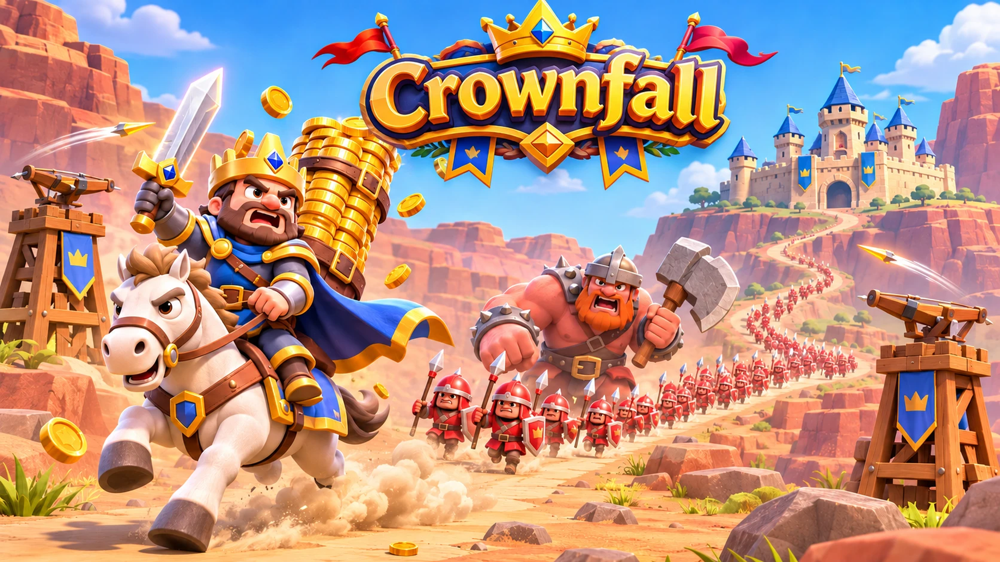
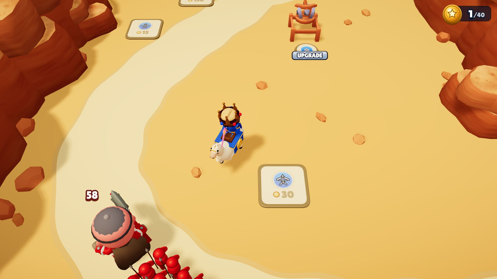
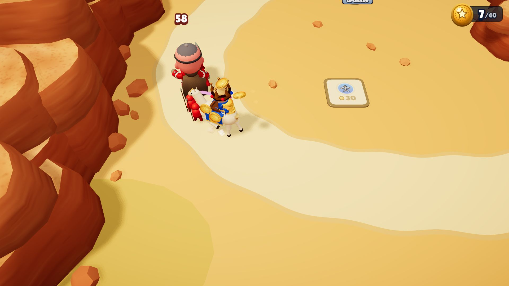
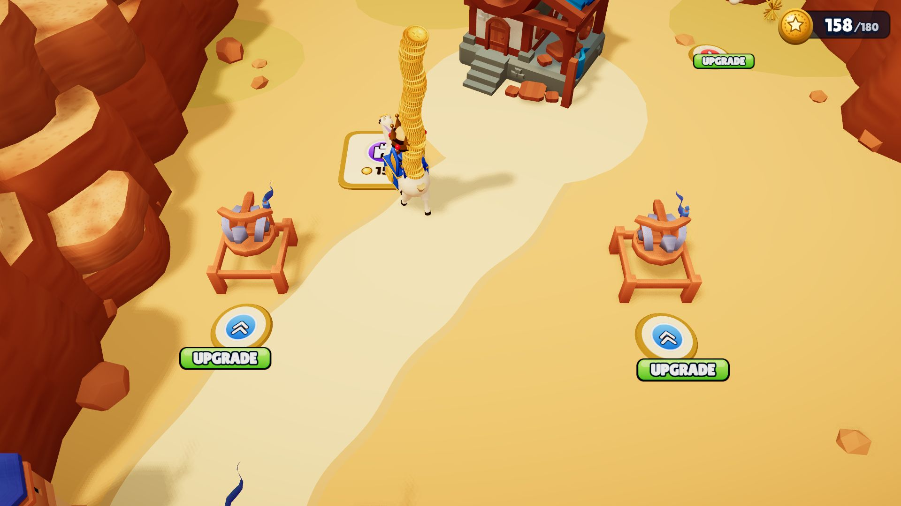
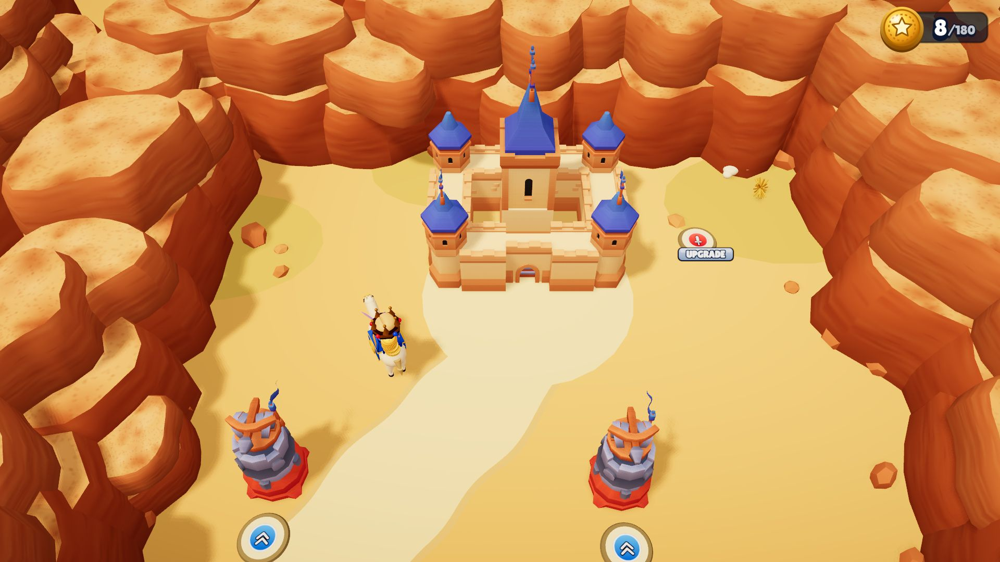
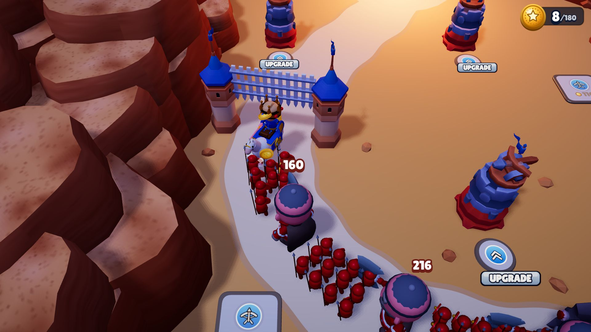

  

<h1 align="center">Crownfall</h1>

  <b>Ride as the king, grab the gold, and build the defenses that hold back the horde!</b> 
  A hands-on tower defense game for your browser, where you fight next to your towers.

  

  <a href="https://bluelolipop1.itch.io/crownfall"><b>bluelolipop1.itch.io/crownfall</b></a> 
  Free, no download, no sign-up. Works on desktop and mobile.

---

## Trailer

  
   
  Click the cover to watch the trailer (<a href="media/trailer/trailer-portrait-1080x1620.mp4">portrait version</a>).

## About the game

You are the hero of this tower defense. Ride your king across the canyon, cut through enemy soldiers and giants, and pick up the gold they drop. Every coin you carry stacks up behind you.

Spend it by riding onto build tiles. Raise ballistas along the road, put a gatehouse in the horde's path, and upgrade your sword, armor and ballistas at the upgrade spots. Save up for the Rebuild to turn your wooden camp into a stone castle, but beware: night falls, and a boss leads the next raid.

Waves grow bigger and smarter as you go. Giants charge at the front, soldiers swarm behind them, and bosses arrive every fifth wave. Protect your fort; if it falls, use your gold to stand it back up at half health, or retry the wave.

## Features

- **Hands-on defense:** you fight alongside your towers instead of just watching them
- **Ride-to-build:** step on a tile to pay for it, with no menus
- **Upgrades:** king (sword, armor, coin bag) and ballistas (damage, fire rate, range)
- **Castle rebuild:** turn your camp into a castle and survive boss nights
- **New regions to unlock:** canyon, frost and ember
- **Saves automatically**

## Controls

| | |
|---|---|
| **Desktop** | WASD or arrow keys to ride, or click and drag to steer |
| **Mobile** | Touch and drag anywhere to steer |
| **Build** | Ride onto a tile to pay for it |
| **Upgrade** | Ride onto an upgrade spot to open the shop |

The king attacks nearby enemies automatically and the ballistas fire on their own.

## Screenshots

| | |
|---|---|
|  |  |
|  |  |
|  | |

## Tech and credits

HTML5 + [Three.js](https://threejs.org/) (WebGL). 3D models are CC0 packs by [Kenney](https://kenney.nl) and [KayKit](https://kaylousberg.itch.io); font Lilita One (OFL). Music and sound effects are synthesized in code. The game code was written with Claude (Anthropic) and the store cover art was generated with an AI image tool.
